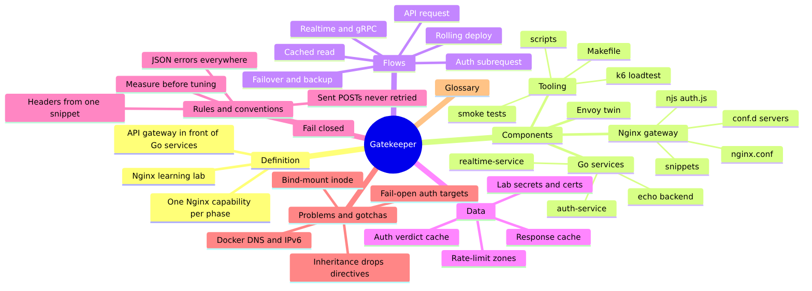
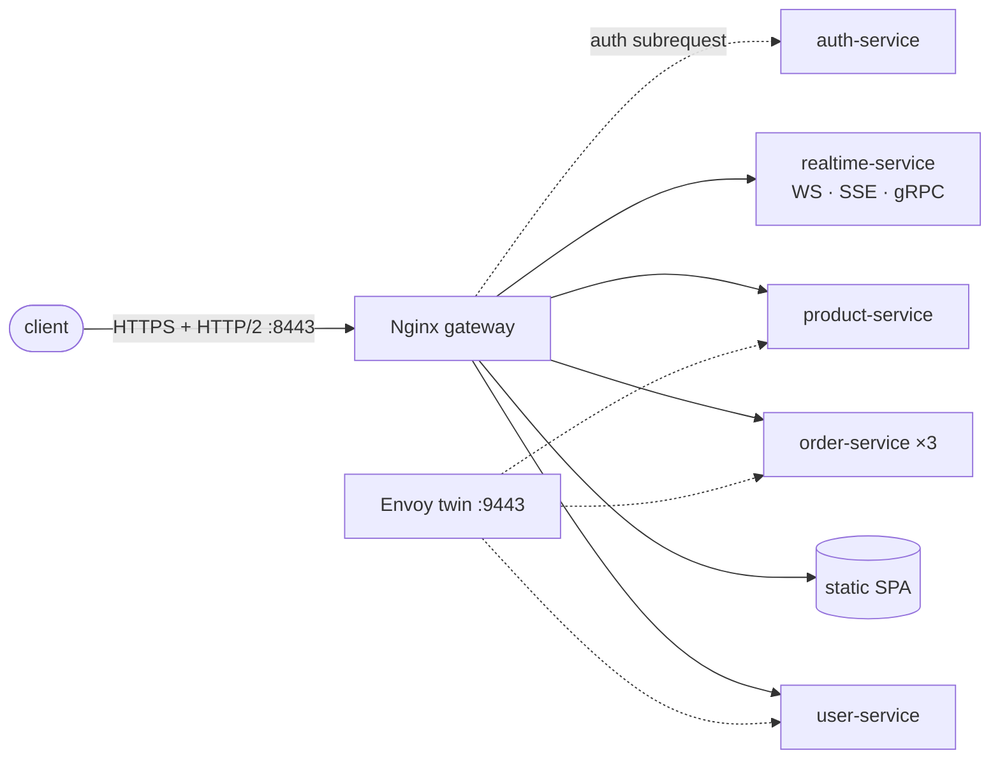

# Gatekeeper

**Learn Nginx by building an API gateway** in front of a few small Go services.

Each of the 12 phases adds one Nginx capability, proves it with real traffic, and then
breaks it on purpose to see how it fails. Every claim in the docs is checked by a smoke
test against the running stack.



**Docs:** [GUIDE.md](GUIDE.md) (every phase in detail) · [mind map](claudedocs/mind-map.md) (components, flows, gotchas, each linked to its file)

## Architecture



Only the gateway (and, on loopback, the Envoy twin) is published; the services live on
the compose network.

## Getting started

Requires Docker (with Compose) and Go 1.26+.

```bash
make up              # build and start everything (creates certs/ and secrets/ on first run)
make test            # smoke test the stack
make test-lifecycle  # + the tests that stop/recreate containers
make reload          # nginx -t && nginx -s reload, no downtime
make logs            # tail the gateway access log
make down            # stop everything
```

Then, once per shell:

```bash
export CURL_CA_BUNDLE=$PWD/certs/ca.pem
export TOKEN=$(jq -c '{username:"alice",password:.alice.password}' secrets/auth/users.json |
  curl -s -X POST -H 'Content-Type: application/json' -d @- https://localhost:8443/api/auth/login | jq -r .token)
curl -H "Authorization: Bearer $TOKEN" https://localhost:8443/api/users/
```

## Roadmap

All 12 phases are done. Each links to its part of the [guide](GUIDE.md).

| Phase | Topic | Status |
|---|---|---|
| 0 | [Foundation: repo skeleton, Go services, Nginx anatomy](#architecture) | ☑ |
| 1 | [Static files & routing](GUIDE.md#routes) | ☑ |
| 2 | [Reverse proxy deep dive: headers, timeouts, buffering](GUIDE.md#proxying) | ☑ |
| 3 | [Load balancing & failover](GUIDE.md#load-balancing) | ☑ |
| 4 | [Observability: logs, request ID, metrics](GUIDE.md#observability) | ☑ |
| 5 | [Rate limiting & protection](GUIDE.md#rate-limiting) | ☑ |
| 6 | [Caching](GUIDE.md#caching) | ☑ |
| 7 | [TLS & HTTP/2](GUIDE.md#tls--http2) | ☑ |
| 8 | [Auth at the gateway & CORS](GUIDE.md#auth--cors) | ☑ |
| 9 | [Realtime & gRPC: WebSocket, SSE, gRPC proxy](GUIDE.md#realtime--grpc) | ☑ |
| 10 | [Performance tuning & zero-downtime](GUIDE.md#performance--zero-downtime) | ☑ |
| 11 | [Stretch: njs, Kubernetes Ingress, Nginx vs Envoy](GUIDE.md#njs) | ☑ |

## Layout

```
gatekeeper/
├── nginx/                  # the gateway: nginx.conf, conf.d/ servers, snippets/, njs/
├── envoy/envoy.yaml        # the Envoy twin, for comparison
├── services/               # one Go module: go.mod, Dockerfile
│   ├── internal/           # echo/ (shared backend), auth/, realtime/
│   ├── cmd/                # user-service/, order-service/, product-service/, auth-service/, realtime-service/
│   └── smoke/              # the test suite behind every claim
├── frontend/ · admin/      # static content served by Nginx
├── loadtest/ · scripts/    # k6 scenarios; certs, secrets, bench, deploy scripts
├── k8s/                    # Ingress and Gateway API examples, never applied
├── Makefile · docker-compose.yml
└── GUIDE.md · claudedocs/  # the detailed guide and the mind map
```

**Stack:** Nginx 1.27 (+ njs) · Envoy 1.38 · Go 1.26 · Docker Compose · k6 0.57.

## Learning method

Every phase follows the same loop: **build** the smallest config that works, **verify**
it with curl, logs or a load test, **break it** on purpose, then **fix and explain** why
the fix works.
