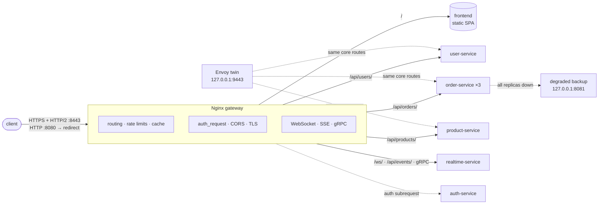

# Gatekeeper

**Learn Nginx by building an API gateway**: routing, load balancing, rate limiting,
caching, TLS, auth, realtime, tuning and zero-downtime deploys, in front of a set of
small Go services.

The services are deliberately simple; the gateway is the point. Each of the 12 phases
adds one Nginx capability, proves it with real traffic, and then breaks it on purpose
to see how it fails. Every claim in this README is checked by a smoke test against the
running stack.

> **New here?** Read [Architecture](#architecture), run [Getting started](#getting-started),
> then skim the [mind map](claudedocs/mind-map.md) for how the pieces fit.

## Contents

| | |
|---|---|
| **Start** | [Architecture](#architecture) · [Mind map](#mind-map) · [Tech stack](#tech-stack) · [Layout](#layout) · [Getting started](#getting-started) |
| **The gateway** | [Routes](#routes) · [Proxying](#proxying) · [Why a 502 or a 504](#why-a-502-or-a-504) · [Load balancing](#load-balancing) · [Observability](#observability) · [Rate limiting](#rate-limiting) · [Caching](#caching) · [TLS & HTTP/2](#tls--http2) · [Auth & CORS](#auth--cors) · [Realtime & gRPC](#realtime--grpc) |
| **Operating it** | [Performance & zero-downtime](#performance--zero-downtime) |
| **Beyond Nginx** | [njs](#njs) · [Nginx vs Envoy](#nginx-vs-envoy) · [Kubernetes](#kubernetes) · [Where to go next](#where-to-go-next) |
| **About** | [Roadmap](#roadmap) · [Learning method](#learning-method) |

## Architecture



Only the gateway (and, on loopback, the Envoy twin) is published; the services are
reachable only on the compose network.

## Mind map

A one-page map of the whole project: components, the main request flows, the data,
the rules the config enforces and the gotchas found along the way, each linked to its
file. **→ [claudedocs/mind-map.md](claudedocs/mind-map.md)**

## Tech stack

| Part | Choice |
|---|---|
| Gateway | Nginx 1.27 (open source, official Docker image; njs since Phase 11) |
| Second gateway | Envoy 1.38 (`envoy/envoy.yaml`, for comparison, since Phase 11) |
| Services | Go 1.26 (standard library `net/http`; since Phase 9 `github.com/coder/websocket` and `google.golang.org/grpc` for realtime-service) |
| Orchestration | Docker Compose |
| Load testing | k6 0.57 in a container (`make bench`, since Phase 10), `curl` |
| TLS (local) | openssl (mkcert optional) |

## Layout

```
gatekeeper/
├── docker-compose.yml       # the stack; only the gateway (and Envoy, on loopback) is published
├── docker-compose.njs.yml   # opt-in: the signing key for the njs auth check
├── Makefile                 # up, test, reload, logs, bench, deploy, down …
├── nginx/                   # mounted at /etc/nginx/gatekeeper (nginx -c .../nginx.conf)
│   ├── nginx.conf           # main context: workers, maps, zones, caches, logs
│   ├── conf.d/              # one file per virtual server, plus the upstream pools
│   ├── snippets/            # reusable blocks (proxy headers, auth, TLS, CORS, gRPC errors)
│   └── njs/                 # njs scripts (auth.js)
├── envoy/envoy.yaml         # the Envoy twin of the gateway (127.0.0.1:9443)
├── services/                # one Go module, one Dockerfile (ARG SERVICE)
│   ├── go.mod
│   ├── Dockerfile
│   ├── internal/
│   │   ├── echo/            # shared handler: /health, JSON echo, chaos, request log
│   │   ├── auth/            # login, HS256 tokens, /verify
│   │   └── realtime/        # WebSocket, SSE and gRPC handlers
│   ├── cmd/
│   │   ├── user-service/
│   │   ├── order-service/
│   │   ├── product-service/
│   │   ├── auth-service/
│   │   └── realtime-service/
│   └── smoke/               # stack tests run by `make test`
├── frontend/                # static files served directly by Nginx (SPA shell + assets/)
├── admin/                   # admin.localhost content, outside the main root
├── loadtest/                # k6 scenarios, tuning candidates/, results/ (git-ignored)
├── scripts/                 # certs, secrets, readiness, bench, bench-compare, deploy
├── k8s/                     # Ingress and Gateway API examples, never applied
├── claudedocs/mind-map.md   # the project mind map
├── certs/                   # made by make certs, git-ignored, mounted read-only
└── secrets/                 # made by make secrets, git-ignored
```

## Getting started

Requires Docker (with Compose) and Go 1.26+ (grpc-go needs it).

```bash
make up        # build and start everything (creates certs/ and secrets/ on first run)
make test      # smoke test the stack (needs `make up` first; briefly restarts user-service only)
make test-lifecycle  # make test + the tests that stop/recreate the stack
make reload    # nginx -t && nginx -s reload (no downtime)
make logs      # tail the gateway access log
make down      # stop and remove all containers
```

`make up` runs `make certs` (lab CA + gateway certificate in `certs/`) and
`make secrets` (signing key, lab users, admin password in `secrets/`) on first run;
neither is ever committed.

Only the gateway is published:
- HTTPS on `localhost:8443`, the app;
- plain HTTP on `localhost:8080`, which redirects to HTTPS (plus `/health`).

The services are reachable only inside the compose network.

Point curl at the lab CA once per shell, and the examples in this README work as
written:

```bash
export CURL_CA_BUNDLE=$PWD/certs/ca.pem   # checked with macOS curl 8.7; otherwise add --cacert certs/ca.pem
```

Since Phase 8, users and orders need a token. Get one for the lab user alice once per
shell; the examples send it:

```bash
export TOKEN=$(jq -c '{username:"alice",password:.alice.password}' secrets/auth/users.json |
  curl -s -X POST -H 'Content-Type: application/json' -d @- https://localhost:8443/api/auth/login | jq -r .token)   # valid 15 min
```

Make a backend slow or flaky (never affects `/health`):

```bash
DELAY_MS=500 FAIL_RATE=0.2 docker compose up -d order-service
docker compose up -d order-service    # back to normal
```

## Routes

Every location sets an `X-Route` response header, so `curl -sI <url> | grep -i x-route` shows which one won. The smoke suite checks every row below against the live gateway.

How Nginx picks a location: an exact `=` match wins at once. Otherwise it remembers the longest matching prefix; if that prefix is `^~`, it wins. If not, the first regex (`~`, `~*`) that matches, in file order, wins. Only when no regex matches does the remembered longest prefix win.

| Host | URL | Winning location (X-Route) | Answered by |
|---|---|---|---|
| localhost:8443 | /api/auth/login | `login` — `= /api/auth/login` | auth-service `/login` (POST; a GET gets 405) |
| localhost:8443 | /api/users/login | `login` — `= /api/users/login` (moved) | nginx: 308 to `/api/auth/login` |
| localhost:8443 | /api/users/42 | `users` — `^~ /api/users/` | user-service, sees `/42` |
| localhost:8443 | /api/users/ | `users` — `^~ /api/users/` | user-service, sees `/` |
| localhost:8443 | /api/users | `users` — `^~ /api/users/` (needs the slash) | nginx: 301 to `/api/users/` (automatic for a `proxy_pass` prefix ending in `/`) |
| localhost:8443 | /api/orders/7 | `orders` — `^~ /api/orders/` | order-service, sees `/7` |
| localhost:8443 | /api/products/7 | `products` — `^~ /api/products/` | product-service, sees `/7` |
| localhost:8443 | /ws/ | `ws` — `^~ /ws/` (WebSocket) | realtime-service `/ws` (needs a token) |
| localhost:8443 | /api/events/ | `events` — `^~ /api/events/` (SSE) | realtime-service `/events` (needs a token) |
| localhost:8443 | /api/products/logo.png | `products` — `^~` beats the asset regex | product-service, sees `/logo.png` |
| localhost:8443 | /api/usersX | `api-404` — `^~ /api/` (no slash after `users`) | nginx: JSON 404 |
| localhost:8443 | /api/unknown | `api-404` — `^~ /api/` | nginx: JSON 404 |
| localhost:8443 | /health | `health` — `= /health` beats `/` | nginx: `{"status":"ok","from":"gateway"}` |
| localhost:8443 | /healthz | `spa` — exact match needs the exact URI | nginx: `index.html` |
| localhost:8443 | /assets/app.css | `static` — regex `\.(css\|js\|png…)$` beats `/` | nginx: the file |
| localhost:8443 | /assets/missing.png | `static` — regex beats `/` | nginx: 404 from `try_files $uri =404`, never the shell |
| localhost:8443 | /settings | `spa` — no regex matches, so the longest prefix `/` wins | nginx: `index.html` (SPA fallback) |
| localhost:8443 | / | `spa` — `/` | nginx: `index.html` |
| admin.localhost | / | `admin` — admin server, `/` | nginx: `admin/index.html` |
| admin.localhost | /api/users/ | `admin` — the admin server has no API routes | nginx: 404 |
| unknown.test | / | `spa` — no `server_name` matches → `default_server` | nginx: `index.html` |

## Proxying

Every proxied location includes `nginx/snippets/proxy-headers.conf`; no `proxy_set_header` lives anywhere else, because one in a location would drop all the inherited ones.

What a backend receives (`curl -s -H "Authorization: Bearer $TOKEN" https://localhost:8443/api/users/ | jq '.host, .headers'`):

| Header | Value | Why |
|---|---|---|
| `Host`, `X-Forwarded-Host` | the client's host (`localhost`) | not the upstream name (`users`) |
| `X-Forwarded-Proto` | `https` | the app is HTTPS-only since Phase 7 |
| `X-Forwarded-For`, `X-Real-IP` | the TCP peer of the gateway, one address | the gateway is the first hop: a client-sent value is **overwritten**, never appended |
| `Forwarded` | removed | same reason |
| `Connection` | empty, over HTTP/1.1 | ready for Phase 3's upstream keepalive |

Read timeouts per route (the longest silence allowed from the backend): users 2s, products 5s, orders 15s; connect 1s everywhere. Errors nginx itself generates come back as JSON, e.g. `{"error":"gateway timeout","status":504,"route":"users"}`; a backend's own error passes through unchanged.

Request bodies above 1 MB get a 413 before any backend is contacted; bodies above 16 KB are written to a temporary file first (`a client request body is buffered to a temporary file` in the gateway log).

## Why a 502 or a 504

Read the gateway error log (`docker compose logs gateway | grep error`). Each row is reproduced by the smoke suite.

| Cause | Status | Error-log phrase | How to reproduce |
|---|---|---|---|
| No address: the service's container is gone, so Docker DNS has no answer | 502 | `no live upstreams` | `docker compose stop user-service`, wait 3s, then `curl -i -H "Authorization: Bearer $TOKEN" https://localhost:8443/api/users/` |
| Stale address: the IP nginx holds belongs to no container (the first ~2s after a stop, before nginx re-resolves) | 504 | `upstream timed out (110: Operation timed out) while connecting to upstream` | `docker compose stop user-service` and `curl` straight away (a race with the 2s re-resolve; the smoke test proxies to an unused IP to get it every time). Nothing refuses the connect, so it waits out `proxy_connect_timeout` (1s) |
| Connection refused: the container is up but nothing listens on that port | 502 | `connect() failed (111: Connection refused)` | point a `proxy_pass` at `user-service:9999` and reload |
| Timed out: the backend accepted the request but stayed silent past `proxy_read_timeout` | 504 | `upstream timed out (110: Operation timed out) while reading response header from upstream` | `DELAY_MS=3000 docker compose up -d user-service`, then `curl -i -H "Authorization: Bearer $TOKEN" https://localhost:8443/api/users/x` |

## Load balancing

Orders runs as three named replicas (`order-service`, `order-service-2`, `order-service-3`), one `server … resolve` line each in `upstream orders`. They run the same binary: the echo's `service` is always `order-service`, and `hostname` (the container id) tells them apart.

```bash
for i in $(seq 1 12); do curl -s -H "Authorization: Bearer $TOKEN" https://localhost:8443/api/orders/ | jq -r .hostname; done | sort | uniq -c
DELAY_MS=800 docker compose up -d order-service-2     # make one replica slow
```

Measured on this stack; numbers are typical single-run values (the smoke suite reproduces every row's direction, not the exact figures):

| Algorithm | Behaviour measured here | Pick it when |
|---|---|---|
| round-robin (default) | 30 sequential requests → 10/10/10. With one replica 800ms slow, it still gets 33% of traffic: mean latency 271ms | replicas are identical and requests cost about the same |
| `least_conn` (shipped for orders) | same slow replica gets 8% of traffic: mean latency 68ms. Sequential requests look like round-robin (every replica has 0 active, ties go round-robin) | request cost varies or a replica can turn slow; orders is allowed 15s, so a stuck replica must not keep its share |
| `ip_hash` | all 30 requests from the host land on one replica: every request comes from the same client IP | you need rough stickiness and clients come from many different networks: IPv4 is hashed on its first three octets, so a whole /24 (or everyone behind one NAT or load balancer) sticks to one server, and adding or removing a server remaps clients |

p95 doesn't separate the two here: `least_conn` still sends ~8% to the slow replica, and anything above 5% puts its 800ms into the p95.

**When a replica fails.**
- **Failure detection:** each server has `max_fails=1 fail_timeout=10s` (nginx's defaults, written down). One failure takes a replica out for 10s.
- **Stopping a replica rarely shows up as errors.** With `resolve`, its name leaves Docker DNS and nginx drops it within ~2s. In that window a GET that hits its old address waits out the 1s connect timeout, then nginx retries it on another replica.
- **A GET can still fail when a replica stops.** Measured with one sequential client: 0 or 1 failure per stopped replica. The failing request logs a connect timeout on the old address, then `no live upstreams` for its retry, although other replicas are up. We believe nginx refuses to pick a retry peer once the resolver has changed the upstream's server list mid-request. With concurrent traffic, every request waiting on the old address at that moment can fail the same way. Avoiding it fully would mean dropping `resolve`, which brings back Phase 1's swapped-IP problem.
- **Retry rules** (`nginx/snippets/upstream-retry.conf`, included by the orders location):
  - `proxy_next_upstream error timeout http_502 http_503`, with one retry (`tries 2`).
  - All tries share orders' 15s budget (`proxy_next_upstream_timeout 15s`).
- **What actually gets retried on orders:** fast failures only — a failed connect, or a replica answering 502/503. A GET that waits out orders' 15s read timeout has used the whole 15s retry budget, so the client gets a 504 with no retry. (The smoke test shows a read-timeout retry on a temporary server with a 1s read timeout.)
- **Retries and writes:** a POST is retried only if it never reached a server (a failed connect sent nothing). Once a POST was sent, it is never retried: the slow replica still runs it once, and the client gets a 504.
- **Recovery takes up to 10s.** A replica that failed while going down stays ejected for `fail_timeout` (10s) after it comes back, even on the same IP. Until then its traffic goes to the other replicas, or to the backup if none are left.

**Backup.** When all three replicas are out, the upstream's `server 127.0.0.1:8081 backup;` answers from inside the gateway (`nginx/conf.d/orders-fallback.conf`):
- **GET / HEAD:** `200 {"degraded":true,"service":"orders-fallback"}` with `X-Degraded: true` and `Cache-Control: no-store`.
- **Any write:** `503`. A success answer would read as "order created" while nothing was written.

**Connections.** `keepalive 32` on every upstream keeps idle connections to the services open, so 40 sequential requests reuse a handful of connections instead of opening 40. It only works because the proxy snippet speaks HTTP/1.1 with an empty `Connection` header.

**Scaling.** A replica added with `--scale` gets traffic within ~2s, with no reload: `resolve` re-reads Docker DNS.

```bash
docker compose up -d --no-deps --scale order-service-3=2 order-service-3   # 4 hostnames answer
docker compose up -d --no-deps --scale order-service-3=1 order-service-3   # back to 3, no failed request
```

## Observability

**Request id.** Every response from a routed location carries an `X-Request-ID`. Errors nginx raises before it picks a location (`400` for a malformed request, `414` for a URI that's too long) don't. The gateway forwards the same id to the service, and the service logs it as `request_id=…`.
- **Client ids are kept only if well-formed:** an id you send is kept when it matches `^[A-Za-z0-9._-]{1,64}$`.
- **Anything else is replaced** with nginx's 32-hex `$request_id`: spaces, `=`, over 64 chars, or two headers. Such a value could forge fields in the services' space-separated `key=value` logs.

```bash
curl -si -H 'X-Request-ID: my-trace-1' -H "Authorization: Bearer $TOKEN" https://localhost:8443/api/users/ | grep -i x-request-id
make trace ID=my-trace-1      # its gateway line and its service line
```

**Access log.** One JSON object per request (`escape=json`, every value a string). The gateway's own `/health` is not logged.
```bash
docker compose logs --no-log-prefix gateway | grep '^{' | tail -1 | jq .
```

| Field | Meaning |
|---|---|
| `time` | request end, ISO 8601 |
| `request_id` | the id above |
| `remote_addr`, `host`, `request`, `user_agent` | who asked for what |
| `status`, `bytes` | what the client got |
| `request_time` | first byte from the client → last byte sent to it: the whole request |
| `route` | the `$route` of the location (`users`, `orders`, `admin`, …) |
| `upstream` | upstream block name (`users`, `orders`, …). Empty when nginx answered itself, and also on the gateway's own JSON 502/504 lines: the `error_page` redirect clears it. Use `route` there |
| `upstream_addr`, `upstream_status` | which server answered, and what it said |
| `upstream_connect_time`, `upstream_header_time`, `upstream_response_time` | time to connect, to the first response byte, and to the whole response from the backend |

Values to expect in the `upstream_*` fields:
- **After a retry:** comma-separated lists, one value per server tried: `"172.19.0.6:8080, 127.0.0.1:8081"`.
- **Requests nginx answers itself** (SPA, static, JSON 404): `""`.
- **Something not measured:** a timing nginx never took (no connect happened, no header arrived) is `"-"`.
- **No server address at all:** when a service is down and nginx had no server to try, `upstream_addr` is the upstream's name (`"users"`) instead of an IP.

**Where the time went.**
- **The backend:** `upstream_response_time` is time spent waiting on the backend(s).
- **Everything else:** `request_time` minus that is client I/O (a slow upload or download) plus nginx's own work.
- **Example:** `request_time` 2s with `upstream_response_time` 0.05s means the service was fast and the client was slow.
- **Finding a slow service:** `DELAY_MS=1500 docker compose up -d product-service`, then read only the gateway log; products stands out at ≥ 1.5s. No service log is needed:
  ```bash
  docker compose logs --no-log-prefix gateway | grep '^{' \
    | jq -r 'select(.upstream_response_time != "") | "\(.route)\t\(.upstream_response_time)"' | sort | uniq -c
  ```
- **Caveat:** with large responses, a slow client can also slow nginx's reads from the backend (response buffering fills up), so treat the split as exact only for small responses.

**Counters.** nginx's `stub_status` page listens on `127.0.0.1:8086` inside the gateway only: not published, not reachable from the compose network. `make status` prints it:
```
Active connections: 2
server accepts handled requests
 120 120 340
Reading: 0 Writing: 1 Waiting: 1
```
A Prometheus exporter and Grafana are not part of the lab. To add them, run `nginx/nginx-prometheus-exporter` in compose with `--nginx.scrape-uri` pointing at a status listener it can reach.

## Rate limiting

| Limit | Applies to | Keyed by | Rate | Burst |
|---|---|---|---|---|
| login | `= /api/auth/login` (and `…/login/`; the old `/api/users/login` paths 308 there) | client IP | 5 r/s | `burst=10 nodelay` |
| api | `/api/users/`, `/api/orders/`, `/api/products/` (one shared bucket) | a known `X-API-Key`, otherwise client IP | 50 r/s | `burst=100 nodelay` |

Over the limit, the client gets `429 {"error":"too many requests","status":429,"route":"…"}` with `Retry-After: 1`, `X-Route` and `X-Request-ID`. The request never reaches a service. The access log records `"limit_req":"REJECTED"` (`PASSED` normally, `-` where no limit applies).

**A spike against `burst=10 nodelay`** (5 r/s):
- **Requests 1–11:** the 1st request plus 10 burst slots are answered at once.
- **The 11th** is the last burst slot.
- **The 12th** (and the rest) gets 429, because the bucket is full.
- **Refill:** the bucket frees one slot every 200ms, so 1s later 5 more are allowed.

Measured: 50 parallel logins → 11 × 200, 39 × 429.

**Without `nodelay`,** the same 11 are accepted but *queued*. They are released one every 200ms, so the 11th waits ~2s; the 12th still gets 429. `delay=N` mixes the two: the first N pass at once, the rest of the burst is queued.

**Dry run:** `limit_req_dry_run on;` lets everything through, and logs `REJECTED_DRY_RUN` for what would have been rejected. Use it to try a limit on real traffic first. Measured: 50 × 200, with 38–39 would-be rejections (one slot can refill while the spike arrives).

**Keys:**
- **Known keys** (`lab-key-alpha`, `lab-key-beta`, in `nginx.conf`) get their own budget.
- **Any other `X-API-Key` value** counts against the sender's IP. So inventing a new key per request buys nothing, and can't fill the zone's memory.
- **Lab only:** these keys live in a config file in this repo, so anyone who reads it can send them and get a second budget. Everyone using one key also shares that key's bucket. They stay after Phase 8: a per-user budget would need the identity before `limit_req` runs (see Auth & CORS).

**Allowlist:** `127.0.0.0/8` and Docker's compose networks `172.16.0.0/12` are never limited.
- **Read from the TCP peer:** `X-Forwarded-For` or `X-Real-IP` can't claim it.
- **Your machine stays limited:** it arrives as `192.168.65.1` (Docker Desktop), so you can watch the limits from your shell.
- **Lab only:** `172.16.0.0/12` is a broad range. On native Linux Docker the host itself is `172.17.0.1`, so your shell would be exempt there and the limit tests would see no 429s. Some real networks use this range too. Docker can also hand out `10.x` or `192.168.x` compose subnets, and IPv6 (`::1`) isn't listed. Narrow it to your actual compose subnet anywhere real.

**What is not limited:**
- **The gateway's own answers:** `/health`, the SPA, static files, `admin.localhost` and `stub_status`.
- **CORS preflights:** the API locations answer them with `return 204` (Auth & CORS).
- **Locations answered by `return`:** `limit_req` runs after nginx's rewrite phase, where `return` already answered. Measured: a `return` location with `limit_req` passed 50/50.

**Slow clients:** `client_header_timeout 5s` cuts off a client that stops sending its headers (no response is sent); `client_body_timeout 10s` does the same for a stalled body. The defaults are 60s.

**One gateway, one counter:** the zones live in this nginx's shared memory. Three gateways would each allow the full rate. Consistent limits across instances need a shared store (Redis), or sticky routing of each client to one gateway.

```bash
seq 1 50 | xargs -P50 -I{} curl -s -o /dev/null -w '%{http_code}\n' https://localhost:8443/api/auth/login | sort | uniq -c   # 11 × 405 (GET), 39 × 429
curl -si https://localhost:8443/api/auth/login | grep -iE 'HTTP|retry-after'
```

## Caching

The gateway keeps a shared cache for `/api/products/*` only (`nginx/snippets/cache-products.conf`, zone `api_cache`, 100m on disk under `/var/cache/nginx/api`). Users and orders are never cached: their answers are per-user or change on every write.

| Rule | Setting | What you see |
|---|---|---|
| A 200 is kept for 30s | `proxy_cache_valid 200 30s` (products location) | first GET `X-Cache-Status: MISS`, repeats `HIT` |
| Key | `$scheme$host$request_uri` | the client's Host is part of the key, so one request with `Host: evil.example` can't plant a body every other client then gets |
| Credentials skip the cache | `proxy_cache_bypass` + `proxy_no_cache` on `Authorization`, `Proxy-Authorization`, `Cookie`, `X-API-Key` | `BYPASS` every time, and nothing is stored |
| A response that sets a cookie is never stored | nginx's default for `Set-Cookie` | `MISS` every time |
| Only GET/HEAD | nginx's default `proxy_cache_methods` | a POST is never a `HIT` |
| Stampede lock | `proxy_cache_lock on`, `proxy_cache_lock_timeout 5s` | 50 concurrent GETs of a cold key reach a slow service once |
| Stale on failure | `proxy_cache_use_stale error timeout updating http_500 http_502 http_503 http_504`, `proxy_cache_background_update on` | with product-service down, a key cached earlier is answered `STALE` (200); one never cached is the JSON 502 |

`X-Cache-Status` is `MISS`, `HIT`, `EXPIRED`, `STALE`, `UPDATING` or `BYPASS`; the access log has the same value in its `cache` field (empty for routes that aren't cached).

```bash
curl -si https://localhost:8443/api/products/demo | grep -i x-cache   # MISS
curl -si https://localhost:8443/api/products/demo | grep -i x-cache   # HIT
curl -si -H 'Authorization: Bearer x' https://localhost:8443/api/products/demo | grep -i x-cache   # BYPASS
```

Things to know:

- The credential list is an allowlist. A backend that reads some other auth header (`X-Auth-Token`, `X-Access-Token`, `Api-Key`, …) needs it added to the `$cache_skip` map in `nginx.conf`, or its personal answers would be shared.
- A HIT is the first requester's answer. The echo body of a HIT still shows that request's `X-Request-Id`, `X-Real-IP` and `User-Agent` (the response header `X-Request-ID` is fresh). That's harmless for a catalogue but is why anything per-user must not be cached.
- Rate limiting runs before the cache: a HIT still counts against the Phase 5 API budget (50 r/s per client), and a 429 has no `X-Cache-Status`.
- The lock waits at most 5s, the same as products' read timeout: if the service hangs, waiters then go to it themselves, so a hung service still sees a stampede.
- The stampede lock only matters when the service is slow: with a fast service, concurrent misses finish before the lock adds anything.

### gzip

`gzip on` for `application/json`, `text/css` and `application/javascript` from 256 bytes (`gzip_min_length 256`), with `gzip_vary on`. A client sending `Accept-Encoding: gzip` gets `Content-Encoding: gzip` and `Vary: Accept-Encoding`; one that doesn't gets plain bytes. `/health` (33 bytes) is never compressed: it would grow.

The cache stores the service's uncompressed body and nginx gzips each answer on the way out, so one entry serves both kinds of client. That relies on the services never gzipping themselves: a backend that did would have its gzip body handed to clients that didn't ask for it, because `Accept-Encoding` is not part of the key.

### Before and after

Measured with product-service slowed to 300ms (`DELAY_MS=300`), ten GETs of one products URL. "Before" sends an `Authorization` header so every GET bypasses the cache (`TestShouldPayTheServiceDelayOnEveryGetWithoutTheCache`); "after" is plain GETs (`TestShouldAnswerRepeatsFromTheCacheWithoutTheServiceDelay`):

| | Latency | Backend hits |
|---|---|---|
| before (cache bypassed: every GET) | 303–310ms each | 10 |
| after (first GET, `MISS`) | 309ms | 1 |
| after (GETs 2–10, `HIT`) | 0.2–0.5ms | 0 |

## TLS & HTTP/2

TLS ends at the gateway; the services stay plain HTTP/1.1 inside the compose network. Since Phase 7 the app is served on **HTTPS only**:

| Port (host → container) | Serves |
|---|---|
| `8443 → 443` | the app, TLS 1.2/1.3, HTTP/2 via ALPN (HTTP/1.1 still works) |
| `8080 → 80` | `/health` in plain HTTP; everything else is a redirect to the same path on `https://$host:8443` |

**Certificates.** `make certs` (run by `make up`) uses openssl to create a lab CA (`certs/ca.pem`, 10 years) and a leaf for `localhost`, `admin.localhost` and `127.0.0.1` (398 days, the longest the browsers accept). Valid files are kept; a leaf within 30 days of expiry is reissued from the same CA. Everything in `certs/` is gitignored. Clients verify with the lab CA: `curl --cacert certs/ca.pem` or `export CURL_CA_BUNDLE=$PWD/certs/ca.pem`; the smoke tests load the same file. For a browser without warnings, either import `certs/ca.pem` into your trust store or use mkcert instead (`mkcert -install` adds its own CA to the system store, which is why the lab doesn't do it for you).

**Redirects.** GET and HEAD get **301**; every other method gets **308**, because a 301 lets clients replay a POST as a GET and drop its body. The target is `https://$host:8443$request_uri`: inside the container the TLS port is 443, so `https://$host$request_uri` would send clients to port 443 on your machine, where nothing listens.

```bash
curl -si localhost:8080/api/users/x?q=1 | grep -iE '^HTTP|location'   # 301 → https://localhost:8443/api/users/x?q=1
curl -si -X POST -d '{}' localhost:8080/api/orders/ | grep -iE '^HTTP|location' # 308, same method and body
curl -s localhost:8443/ | grep -o 'The plain HTTP.*port'                # 400 page: "The plain HTTP request was sent to HTTPS port"
curl -sI -H "Authorization: Bearer $TOKEN" https://localhost:8443/api/users/ | head -1   # HTTP/2 200
curl -sI --http1.1 -H "Authorization: Bearer $TOKEN" https://localhost:8443/api/users/ | head -1   # HTTP/1.1 200
```

**HSTS.** Every HTTPS answer from a location (pages, API, the JSON error pages) carries `Strict-Transport-Security: max-age=300`; plain HTTP answers don't (browsers ignore it there), and neither do errors nginx returns before choosing a location, such as the 400 below. The max-age is 5 minutes on purpose: a long one would pin `localhost` to HTTPS in your browser for every other local project you run. No `includeSubDomains`, so `admin.localhost` isn't pinned by the main host. Production would use a year and, once sure, preload.

**Protocol settings** (`nginx/snippets/tls.conf`, included by every 443 server with `http2 on;`):

- `ssl_protocols TLSv1.2 TLSv1.3`: a TLS 1.1 client fails the handshake (Go reports `protocol version not supported`, openssl `alert protocol version`).
- TLS 1.2 ciphers: the ECDHE-RSA AEAD suites of Mozilla's "intermediate" profile; TLS 1.3 chooses its own.
- `ssl_session_cache shared:SSL:10m`, `ssl_session_timeout 1d`, `ssl_session_tickets off`: resumption comes from the server-side cache, not from tickets whose key would never rotate here. Measured with `openssl s_client -connect localhost:8443 -tls1_2 -reconnect`: 5 of 5 reconnects print `Reused`.
- No OCSP stapling: a private CA has no OCSP responder.

**What changed for clients.**

- `X-Forwarded-Proto` is now `https`, so backends build https links.
- The cache key includes `$scheme`, so HTTPS entries are separate.
- Rate limits are per client IP whatever the protocol. Over HTTP/2 one connection carries every request, and each request still counts: the 12th quick login on one connection is a 429.

**Go clients and HTTP/2.** An `http.Transport` with its own `TLSClientConfig` stays on HTTP/1.1 unless `ForceAttemptHTTP2: true` is set; `http.DefaultTransport` already sets it. HTTP/2 setup also appends `h2` to the `tls.Config` it's given, so give each transport its own `Clone()`, or an HTTP/1.1-only transport sharing it will offer h2 it can't speak.

Not in this phase: HTTP/3/QUIC (nginx has the module, but neither the host curl nor the Go standard library can check it), mTLS to the services, and automatic trust-store installation.

## Auth & CORS

The gateway decides who may call what; services trust the identity it passes on and never check tokens themselves.

| Route | Who may call it |
|---|---|
| `POST /api/auth/login` | anyone (login zone: 5 r/s, burst 10) |
| `/api/users/`, `/api/orders/` | a valid token; DELETE on orders needs role `admin` |
| `/api/products/`, `/health`, static, SPA | anyone (products stays a shared cache) |
| `admin.localhost` | the admin Basic login (`auth_basic`) |

**Secrets.** `make secrets` (run by `make up`) writes `secrets/auth/jwt.key` (32 random bytes), `secrets/auth/users.json` (lab users `alice`, role `user`, and `admin`, role `admin`, with random passwords) and `secrets/gateway/admin.htpasswd` (apr1, the admin user's password). `secrets/` is gitignored. Each half is mounted only into its own container: the gateway can check the admin password but never holds the signing key. Non-empty files are kept; an empty one is regenerated. Running `docker compose up` without `make secrets` leaves auth-service exiting with "run make secrets".

```bash
TOKEN=$(jq -c '{username:"alice",password:.alice.password}' secrets/auth/users.json |
  curl -s -X POST -H 'Content-Type: application/json' -d @- https://localhost:8443/api/auth/login | jq -r .token)
curl -s https://localhost:8443/api/users/ | jq .                                   # 401 {"error":"unauthorized",…}
curl -s -H "Authorization: Bearer $TOKEN" https://localhost:8443/api/users/ | jq .headers  # X-User-Id: alice, X-User-Role: user
curl -s -X DELETE -H "Authorization: Bearer $TOKEN" https://localhost:8443/api/orders/1 | jq .   # 403 forbidden (user role)
```

**The token flow.**

1. auth-service's `POST /login` returns an HS256 token (`sub`, `role`, `iat`, `exp` = 15 min). It's short because a token can't be revoked before it expires.
2. Each users/orders request makes nginx run `auth_request /_auth`, an internal subrequest to auth-service's `GET /verify`. The subrequest carries the client's headers but no body, plus `X-Original-Method`.
3. `/verify` answers 204 with `X-User-ID`/`X-User-Role`, 401 for any bad token (missing, malformed, wrong key, expired, no `exp`, any `alg` but HS256), or 403 when a `user` tries a DELETE.
4. nginx copies the identity into `X-User-ID`/`X-User-Role` with `auth_request_set` and `proxy_set_header`. Those overwrite whatever the client sent. On public routes they're empty, which drops a client's forged value too.

**Failing closed.** If auth-service is unreachable, `auth_request` answers 500, which `error_page 500 = @auth_unavailable` turns into a JSON **503** `{"error":"auth unavailable",…}`. The `=` matters: without it the client would still see 500. Protected routes stop; public ones keep working.

**The verdict cache.** Asking `/verify` on every call costs a hop, so nginx caches a 204 for **10s**, keyed by token + method. Five calls with one token make one `/verify`. A 401 or 403 is never cached. The trade-off: a token stays accepted up to 10s past its `exp`. The cache key holds the token, so the cache files are secrets too.

**Order inside nginx.** `limit_req` runs in the preaccess phase, `auth_request` in access. A rate limit therefore can't be keyed on the verified user: the identity doesn't exist yet. Per-user limits would need the token checked earlier, in njs (`js_set`), which means putting the signing key in the gateway. That's why the Phase 5 API-key buckets stay as they are.

**Admin host.** `admin.localhost` has `auth_basic` with the generated htpasswd; a browser shows its login prompt (`WWW-Authenticate: Basic`). Its location serves files with `try_files`. A location that answers with `return` would skip the check, because `return` runs before the access phase.

**CORS.** Browsers on `https://app.localhost:8443` and `http://localhost:5173` (a typical dev server) may call the API; every other origin, `null` and look-alikes such as a trailing slash included, gets no `Access-Control-*` header at all, so its browser blocks the answer. A plain `OPTIONS` without `Access-Control-Request-Method` is not a preflight and goes through auth.

- **Preflight:** an `OPTIONS` with `Access-Control-Request-Method` is answered **204** by `return` in the five API locations (both login spellings, users, orders, products), before the rate limit and auth, since browsers send preflights without a token. It carries `Access-Control-Allow-Origin` (the caller's origin), `Allow-Methods: GET, POST, DELETE, OPTIONS`, `Allow-Headers: Authorization, Content-Type, X-Request-ID` and `Max-Age: 600`. The trade-off is that preflights are never rate-limited.
- **Real answers:** these carry `Access-Control-Allow-Origin`, `Access-Control-Expose-Headers: X-Request-ID` and `Vary: Origin`, and so do the JSON 401/403/429/502 pages. Without that, a browser would hide the real error from the app.
- **No `Access-Control-Allow-Credentials`:** tokens travel in `Authorization`, not cookies.
- **Cached products answers:** these get each requesting origin's own header, because `add_header` runs when the answer is served.

```bash
curl -si -X OPTIONS -H 'Origin: http://localhost:5173' -H 'Access-Control-Request-Method: DELETE' \
  https://localhost:8443/api/orders/ | grep -i '^HTTP\|access-control'
```

**Login moved.** The login route is `POST /api/auth/login` (auth-service); the Phase 5 paths `/api/users/login` and `/api/users/login/` answer 308 there.

## Realtime & gRPC

`realtime-service` (Go 1.26) serves three kinds of long-lived or HTTP/2 traffic. The gateway proxies all three behind the Phase 8 token and the Phase 5 limits:

| Route | Protocol | Library | Upstream |
|---|---|---|---|
| `/ws/` | WebSocket (echo: `alice: hi`, a ping every 30s) | `github.com/coder/websocket` | `realtime-service:8080/ws` |
| `/api/events/` | Server-Sent Events (`id:` + `data:` every 1s, `: heartbeat` every 15s, resumes after `Last-Event-ID`) | standard library | `realtime-service:8080/events` |
| `/gatekeeper.Echo/Say`, `/grpc.health.v1.Health/Check` | gRPC (unary; Echo is hand-described with protobuf's `StringValue`, no protoc) | `google.golang.org/grpc` (grpc-go) | `grpc_pass grpc://realtime-service:9090` (h2c) |

```bash
# SSE: id/data lines every second, a heartbeat comment every 15s
curl -sN --max-time 5 -H "Authorization: Bearer $TOKEN" https://localhost:8443/api/events/
# WebSocket: any client, e.g. websocat (brew install websocat); type a line, get "alice: <line>"
websocat "wss://localhost:8443/ws/?access_token=$TOKEN"
# gRPC: the server has no reflection, so grpcurl would need the .proto files;
# the smoke tests are the client (they dial localhost:8443 with the lab CA)
cd services && go test -count=1 -tags smoke -run GRPC ./smoke/
```

**WebSocket: the Connection header.** An upgrade needs `Upgrade: websocket` and `Connection: upgrade` passed to the backend. `proxy-headers.conf` used to force `Connection ""` for Phase 3's upstream keepalive, and a second `proxy_set_header Connection` in the same location would have sent two values. So the snippet now uses `$connection_upgrade` (a map over `$ws_route:$http_upgrade`): `upgrade` only in the `/ws/` location (which sets `$ws_route`) and only for `Upgrade: websocket`, empty otherwise. Keepalive is untouched, and no other route can be turned into a tunnel by a client-sent `Upgrade`.

**HTTP/2 clients.** nginx has no WebSocket over HTTP/2 (RFC 8441, extended CONNECT). Measured: a client that negotiated `h2` by ALPN still gets its WebSocket, because the upgrade request goes out as HTTP/1.1 and nginx (1.25+) accepts HTTP/1.1 on that connection. Browsers open a separate HTTP/1.1 connection for a WebSocket anyway.

**Timeouts vs heartbeats.** `proxy_read_timeout` is the longest *silence* allowed, so the stream routes allow `1h`. The service makes sure there's never that much silence: a WebSocket ping every 30s, an SSE `: heartbeat` comment every 15s. Measured: idle streams stay open past 20s, longer than any other route's timeout (orders 15s).

**SSE and buffering.** The SSE location has `proxy_buffering off`, and the service sends `X-Accel-Buffering: no`. Measured in the Phase 9 probe: with buffering *on*, events still arrived on time (+0/+500/+1000ms). nginx forwards what it has whenever the client can take it. Buffering only hurts with a slow client (nginx keeps reading ahead into memory or a temp file), gzip (which waits to fill a block), or a cache. So it's off on principle, not because a test can see a delay here. `text/event-stream` isn't in `gzip_types`, and the route is never cached.

**Tokens for browsers: `?access_token=`.** A browser `WebSocket` or `EventSource` can't set `Authorization`, so the realtime routes also accept the token in the query:
- The location captures it before auth (`set $rt_bearer`), because the `/_auth` subrequest has no query string of its own.
- The subrequest sends it as `Authorization`, and the verdict cache keys on that effective value, so query tokens never share one empty-header entry.
- `$args_without_token` removes it, in any capitalisation (nginx's `$arg_` lookup ignores case, so the strip must too), from the query sent to the service.
- Two `access_token` parameters, or a percent-encoded name like `access%5Ftoken`, get a **400** before auth, so no second token can ride past the strip.
- Only `/ws/` and `/api/events/` accept it; `/api/users/?access_token=…` is still a 401.

Keeping it out of logs:
- **Access log:** the `request` field is now `$request_method $request_path $server_protocol` on every route. `$request_path` is the requested path without its query, taken from `$request_uri`, so it also survives internal redirects such as the SPA fallback.
- **Error log:** a line there prints the raw request line, token included, whenever nginx refuses or fails a request (rate limit, `limit_conn`, auth or upstream down). The two realtime locations therefore set `error_log … crit`, which they never produce, so they write no error lines at all. The access log still records every status. The cost: realtime problems show up as statuses there, not as error-log explanations.

**`limit_conn`.** `limit_req` counts requests, but a stream is one request that stays open, so a client could hold hundreds. `limit_conn streams 10` caps simultaneous realtime connections per client IP (the login zone's key, so compose networks are exempt). The 11th gets a JSON 429 `{"error":"too many connections",…}`. Both limits share the 429 page; `$limit_req_status` says which one fired.

**Reloads and open streams.** `nginx -s reload` starts new workers; old workers keep their open connections, so a WebSocket would keep an old worker, and the old config, alive for hours. `worker_shutdown_timeout 30s` makes old workers close what's left after 30s. Tested: a WebSocket still works right after the reload and is closed within 35s (the timeout plus a margin). On SIGTERM, realtime-service itself ends its streams (WebSocket close 1001), drains gRPC for up to 3s and exits 0 well inside docker's 10s.

**gRPC through `grpc_pass`.**
- **Transport:** the client speaks HTTP/2 over TLS to `localhost:8443` with the lab CA; nginx speaks h2c (HTTP/2 without TLS) to `realtime-service:9090`.
- **Identity:** `grpc_set_header` (in `snippets/grpc-headers.conf`) passes the verified identity as metadata (`x-user-id`), replacing anything the client sent.
- **Rate limit:** each RPC is one request, so a burst of 150 RPCs on one connection hits the Phase 5 API budget.

**gRPC errors.** A gRPC client reads `grpc-status`, not the HTTP code. nginx's own errors must therefore be gRPC's error-only answer: HTTP 200, `content-type: application/grpc`, `grpc-status`, `grpc-message`. These answers carry `X-Request-ID`, like every other gateway answer. A non-POST request to a gRPC path isn't a gRPC client and gets a plain 405.

| nginx outcome | gRPC status |
|---|---|
| no or bad token (401) | `UNAUTHENTICATED` (16) |
| forbidden (403) | `PERMISSION_DENIED` (7) |
| rate limit (429), body over `client_max_body_size` 1m (413) | `RESOURCE_EXHAUSTED` (8) |
| malformed request (400) | `INVALID_ARGUMENT` (3) |
| auth-service or realtime-service down (500/502/503/504; connect timeout 1s) | `UNAVAILABLE` (14) |

The trap, measured: a `return 204` with the gRPC headers doesn't work. A 204 carries no content-type, so clients only report "malformed header: missing HTTP content-type".

## Performance & zero-downtime

### Measuring

```sh
make bench                                   # k6, mixed scenario: median req/s, p95, failed checks
SCENARIOS="mixed static orders" RUNS=5 make bench
CANDIDATE=open-file-cache SCENARIOS=static make bench-compare
```

`make bench` runs [k6](https://k6.io) in a container on the compose network, so
it measures the gateway, not Docker Desktop's port forwarding, and it isn't
subject to the Phase 5 rate limits (the compose network is exempt). Each scenario
gets one warm-up run, which is thrown away (cold runs measured 13.8k, 28.6k and
37.3k req/s in a row), then `RUNS` measured runs. It prints the medians:
`<scenario> <req/s> <p95 ms> <failed checks>`. Each run's JSON summary goes to
`loadtest/results/`.

| Scenario | What it does |
|---|---|
| `mixed` | users and orders with the lab token (auth_request + upstream), plus the cached `/api/products/bench` |
| `static` | the SPA shell and an asset, served by nginx itself |
| `orders` | 30 users doing GET and POST on orders as admin; also checks that no answer is degraded (`X-Degraded`) |

`make bench-compare` swaps one candidate from `loadtest/candidates/` in and out.
It runs baseline and candidate alternately (interleaved, with the order flipped
every round), so drift on a busy laptop hits both sides alike, and restores the
config afterwards, even when a run fails. A candidate that is already in the
config (a kept one) is refused, since there would be nothing to compare.

### What was tuned

A candidate is kept only if it gains at least 10% in median req/s or p95.
Medians of 3 interleaved runs of 15s, 50 users, on the lab machine (12 CPUs,
Docker Desktop):

| Candidate | Scenario | Baseline | Tuned | Change | Verdict |
|---|---|---|---|---|---|
| `open-file-cache` | static | 20645 req/s, p95 4.99ms | 123071 req/s, p95 1.10ms | +496% req/s, −78% p95 | kept |
| `njs-auth` | mixed | 43149 req/s, p95 3.16ms | 15068 req/s, p95 8.71ms | −65.1% req/s, +175.6% p95 | rejected |
| `access-log-buffer` | mixed | 51799 req/s, p95 2.65ms | 53968 req/s, p95 2.46ms | +4.2% req/s, −7.2% p95 | rejected |
| `keepalive-requests` | mixed | 51789 req/s, p95 2.61ms | 52801 req/s, p95 2.53ms | +2.0% req/s, −3.1% p95 | rejected |
| `upstream-keepalive` | mixed | 51092 req/s, p95 2.65ms | 50607 req/s, p95 2.68ms | −0.9% req/s, +1.1% p95 | rejected |

- **open_file_cache** wins big here because the static files sit on a Docker
  Desktop bind mount, where every `open()`/`stat()` crosses into the VM. On a
  native Linux filesystem the gain would be much smaller.
- **Buffered access logs** help a little but stay under the bar. They would
  also delay log lines by up to 200ms.
- **keepalive_requests 10000** changes nothing: k6 keeps its connections well
  under the default of 1000 requests in a 15s run.
- **upstream keepalive 64**: 32 idle connections per worker are already enough
  for this load.
- **njs auth** (Phase 11, see "njs" below) gives the same answers but is far
  slower here: the baseline answers almost every check from its 10s verdict
  cache, while njs runs the HMAC check in a fresh VM clone for every request.
- **worker_rlimit_nofile** was never a candidate: the container already allows
  1048576 open files, far more than 12 workers × 1024 connections need.

### Zero-downtime

**Config changes: `make reload`.** nginx checks the new config, starts new
workers with it, and tells the old ones to stop accepting connections and finish
what they're doing. Requests already in flight finish on the old config.
Long-lived streams (WebSocket, SSE) get up to `worker_shutdown_timeout` (30s)
before an old worker closes them. Three reloads under the `orders` load: 0
failed checks.

**Service changes: `make deploy SERVICE=order-service`.** This is a rolling
redeploy. The image is built once, then each replica in turn goes through these
steps:

1. Mark the replica `down` in `nginx/conf.d/upstreams.conf` and reload, so no new
   request goes to it.
2. Wait until every worker from before the reload has exited. An old worker
   exits only when its requests are done, so the ones already on that replica
   have answered, unless `worker_shutdown_timeout` (30s) cut them first.
3. Recreate the replica and wait until it is healthy (at most 30s).
4. Remove `down` and reload.

```sh
make deploy SERVICE=order-service
```

Draining is what makes this safe. The gateway never retries a POST (Phase 3),
so simply recreating a replica can fail the POSTs it is serving: 2 of 674221
requests failed when this phase was planned. With draining, a 4s POST that
is in flight when the deploy starts answers 200 before its replica is
recreated, and a deploy under the `orders` load (30 users, GET and POST) has 0
failed checks and no degraded (`X-Degraded`) answers.

The deploy refuses to start when a replica is already marked `down` or isn't
running, so it never takes two replicas out at once. If a new replica never
gets healthy, the deploy stops and leaves that replica marked `down`; the
others keep serving. Fix it and remove that `down` by hand, then deploy
again. Any other failure, including Ctrl-C, puts the replica back in rotation.
The script edits `upstreams.conf` with python3 rather than `sed -i`, because
`sed -i` replaces the file and the gateway's bind mount would keep the old one.

**What still causes downtime: recreating the gateway** (`docker compose up
--force-recreate gateway`, or a change to its compose settings). It is one
container holding the listening sockets, so new connections are refused until
it is back, and Docker Desktop's IPv6 localhost forwarding returns a little
later than IPv4. Removing that would take a second gateway behind a load
balancer or a shared socket, which is out of scope for this lab.

## njs

[njs](https://nginx.org/en/docs/njs/) is nginx's JavaScript. The official
image ships it as a dynamic module, so `nginx.conf` only needs
`load_module modules/ngx_http_js_module.so;` and `js_import`.

`nginx/njs/auth.js` does auth-service's token check inside the gateway:
- the fixed HS256 header;
- HMAC-SHA256 with the signing key, compared in constant time;
- `exp`, `sub` and `role` required;
- DELETE for admins only.

It answers on an internal `location = /_auth_njs` with 204 plus `X-User-ID` /
`X-User-Role`, or 401 or 403, the same contract as `/_auth`. Switching
`auth_request /_auth;` to `/_auth_njs` in `snippets/auth-check.conf` (the
`njs-auth` candidate) changes nothing a client can see. The test suite runs the
whole Phase 8 auth matrix both ways and compares the answers.

What it taught:

- **Read variables from the subrequest's answer.** `auth_request_set` reads
  `$sent_http_x_user_id`, not `$upstream_http_x_user_id`. A `js_content`
  location has no upstream, so the `$upstream_http_*` form comes back empty.
  `$sent_http_*` works for both checks.
- **An unknown `auth_request` target fails open.** Before `/_auth_njs`
  existed, pointing `auth_request` at it let every request through: the URI
  fell through to the site, which answered 200, and `auth_request` treats any
  2xx as allowed. The check has to be an exact, internal location.
- **JavaScript doesn't check types for you.** Go's `json.Unmarshal` into
  `int64`/`string` rejects `"exp":"9999999999"` or `"role":["admin"]`. A
  truthiness check in JS accepts both, and an array role then reads as
  `admin`. The njs check tests the types explicitly. A second test matrix
  (mistyped claims, non-object payloads, malformed tokens) proves both checks
  agree.
- **Every request gets a fresh VM clone.** Anything computed during a request
  is gone by the next one. Only top-level code, run at config load, is shared,
  so the key is read there.
- **Faster on paper isn't faster here.** The subrequest version answers almost
  every check from its 10s cache. njs runs the check every time and measured
  65% slower (see the tuning table), so `auth_request` stays the default.
- **Local checks need the key.** To verify HS256 locally, the gateway needs
  the signing key, and with it the gateway could also mint tokens. Phase 8
  keeps the key out of the gateway, and the default stack still does. The key
  is mounted only through the opt-in `docker-compose.njs.yml` (read-only, just
  `jwt.key`, never `users.json`), and never appears in `nginx -T` or the logs.
  To try the njs check:

  ```sh
  docker compose -f docker-compose.yml -f docker-compose.njs.yml up -d gateway
  CANDIDATE=njs-auth make bench-compare
  docker compose up -d --force-recreate gateway   # back to the default, without the key
  ```

  A real setup would sign with ES256 or RS256 and give the gateway only the
  public key.

## Nginx vs Envoy

`envoy/envoy.yaml` runs a second gateway, Envoy 1.38, on
`https://localhost:9443` (loopback only), in front of the same services:

```sh
curl --cacert certs/ca.pem https://localhost:9443/api/products/1
make bench-gateways                 # nginx and Envoy, same k6 load, interleaved
SCENARIOS=mixed TARGET=envoy make bench
```

| Gatekeeper (nginx) | Envoy twin |
|---|---|
| `location ^~ /api/users/` + `proxy_pass http://users/;` | route `prefix: /api/users/` + `prefix_rewrite: /` |
| `upstream orders { server … ×3; }`, round-robin | cluster `orders`, `STRICT_DNS`, `ROUND_ROBIN` |
| `proxy_next_upstream` without `non_idempotent` | `retry_policy` only on a route that matches `:method GET` |
| `auth_request /_auth;` → auth-service `GET /verify` | `ext_authz` → auth-service `<method> /verify<path>` |
| `auth_request_set` + `proxy_set_header X-User-ID` | `allowed_upstream_headers` (set, replacing a client's) |
| `nginx -s reload`: new workers, old ones drain | `envoy.yaml` is static here; real setups push config over xDS |

Medians of 3 interleaved runs (`make bench-gateways`), 50 users, 15s, from
the compose network, on the lab machine (12 CPUs, Docker Desktop):

| Scenario | nginx | Envoy |
|---|---|---|
| mixed | 51248 req/s, p95 2.62ms | 29750 req/s, p95 3.81ms |
| orders | 37523 req/s, p95 3.50ms | 27275 req/s, p95 3.93ms |

Read the numbers with what each side does:

- **nginx answers much of this load from caches Envoy doesn't have.** Its auth
  **verdict cache** (10s) means one `auth_request` covers thousands of
  requests. Envoy asks auth-service on every request. `mixed` also hits the
  products response **cache** (Phase 6), which Envoy proxies every time.
- **Only nginx has:**
  - the response cache;
  - the **rate limits** (Phase 5): the bench is exempt on nginx anyway;
  - the JSON **error pages** (Envoy answers with its own plain bodies);
  - the static site and the admin host;
  - WebSocket, SSE and gRPC routes;
  - `stub_status`.
- **Only Envoy has:**
  - an **admin** endpoint with per-cluster stats, not enabled here;
  - dynamic config over xDS.
- **Tuned vs defaults.** nginx carries Phase 10's measured tuning; Envoy runs
  with defaults. k6 and both gateways share one Docker Desktop VM, so this
  measures these two setups on this machine, not the engines in general.

What building the twin taught:

- **Envoy's `ext_authz` allows only a 200.** auth-service's 204 came back to the
  client as an empty answer. So the Envoy path answers 200, while nginx's
  `GET /verify` stays 204.
- **The check goes to `/verify<client path>` with the client's method.** Before
  auth-service had a `/verify/` handler, its echo answered 200 there and Envoy
  let every request through, the same fail-open trap as an unknown
  `auth_request` target.
- **Paths must be normalized before the check.** Without `normalize_path`,
  `/api/products/%2e%2e/users/` skipped auth.
- **Docker DNS and a stopped replica.** Envoy keeps a stopped replica's last
  address (Docker stops answering for its name). GETs are retried elsewhere;
  POSTs to it fail, by design, as on nginx.

## Kubernetes

Gatekeeper runs on Docker Compose. On Kubernetes, the same gateway is an
**Ingress** controller or, now, a **Gateway API** implementation. The
`k8s/` files show both. They are examples only: no Make target or script runs
`kubectl` or `helm`, so nothing here can touch whatever cluster your kube
context points at.

| Gatekeeper | Ingress (`k8s/ingress.yaml`) | Gateway API (`k8s/gateway-api.yaml`) |
|---|---|---|
| `server_name`, `listen 443 ssl` | `spec.rules[].host`, `spec.tls` | `Gateway` listener, `protocol: HTTPS`, `certificateRefs` |
| `location ^~ /api/users/` + `proxy_pass …/;` | regex path + `rewrite-target` annotation | `HTTPRoute` `PathPrefix` + `URLRewrite` `ReplacePrefixMatch` |
| `upstream orders` (3 replicas) | a `Service` with 3 pods | `backendRefs` to the same `Service` |
| `auth_request` | `auth-url` annotation (controller-specific) | the controller's policy resource (not core API) |
| `limit_req` | `limit-rps` annotation (controller-specific) | the controller's policy resource (not core API) |

**ingress-nginx is retired.** The Kubernetes project's ingress-nginx
controller, the one most "Nginx Ingress" guides describe, is retired (no
maintenance since March 2026). Its features lived in annotations, so the same
Ingress meant different things on different controllers. Gateway API is the
current path:
- routes, rewrites, TLS and traffic splitting are typed fields;
- auth and rate limits attach as the implementation's policies, for example
  NGINX Gateway Fabric (nginx underneath) or Envoy Gateway (Envoy
  underneath).

The routing carries over directly. The rest depends on the controller:
- auth and rate limits become its policies;
- the response cache, njs, the JSON error pages and the realtime tuning have no
  core Gateway API equivalent.

## Where to go next

The lab covered nginx from static files to zero-downtime deploys. Ways to
keep going, roughly from closest to furthest:

- **Asymmetric tokens.** Sign with ES256 in auth-service and give the gateway
  only the public key. njs can then check tokens locally without being able
  to mint them (README "njs"), which is the way JWT gateways usually work.
- **Run it on a local cluster.** Use kind with its own kubeconfig, never the
  default context. Install NGINX Gateway Fabric, apply `k8s/gateway-api.yaml`,
  then point `make bench` at the cluster's port and compare.
- **Observability beyond logs.** Export nginx and Envoy metrics to Prometheus
  (nginx-prometheus-exporter reads `stub_status`; Envoy has `/stats/prometheus`)
  and trace requests with OpenTelemetry, keeping the request id from Phase 4.
- **Envoy's dynamic side.** Replace `envoy.yaml` with an xDS control plane
  and watch config change without a restart.
- **Production hardening.** Run several gateway replicas behind a load
  balancer (so recreating one isn't downtime), add a WAF (ModSecurity or
  Coraza), and get certificates from ACME instead of the lab CA.

## Roadmap

All 12 phases are done. Each links to the README section it built.

| Phase | Topic | Status |
|---|---|---|
| 0 | [Foundation: repo skeleton, Go services, Nginx anatomy](#architecture) | ☑ |
| 1 | [Static files & routing](#routes) | ☑ |
| 2 | [Reverse proxy deep dive: headers, timeouts, buffering](#proxying) | ☑ |
| 3 | [Load balancing & failover](#load-balancing) | ☑ |
| 4 | [Observability: logs, request ID, metrics](#observability) | ☑ |
| 5 | [Rate limiting & protection](#rate-limiting) | ☑ |
| 6 | [Caching](#caching) | ☑ |
| 7 | [TLS & HTTP/2](#tls--http2) | ☑ |
| 8 | [Auth at the gateway & CORS](#auth--cors) | ☑ |
| 9 | [Realtime & gRPC: WebSocket, SSE, gRPC proxy](#realtime--grpc) | ☑ |
| 10 | [Performance tuning & zero-downtime](#performance--zero-downtime) | ☑ |
| 11 | [Stretch: njs, Kubernetes Ingress, Nginx vs Envoy](#njs) | ☑ |

Personal phase notes live in `docs/` (kept local, not committed). For how the
pieces fit together, see the [mind map](claudedocs/mind-map.md).

## Learning method

Every phase follows the same loop:

1. **Build** the feature with the smallest config that works.
2. **Verify** it with `curl -v`, logs, or a load test.
3. **Break it** on purpose (wrong config, dead upstream, traffic spike) and observe.
4. **Fix and explain** why the fix works.
