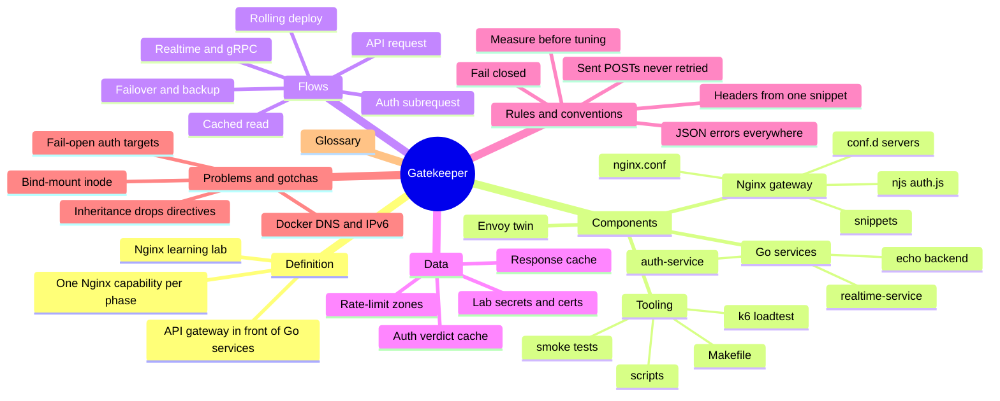
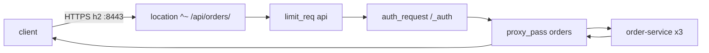
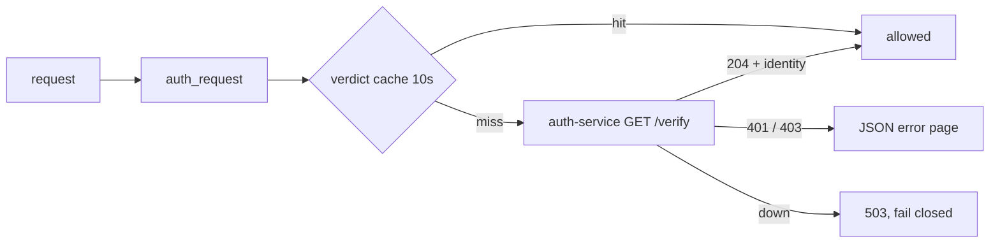
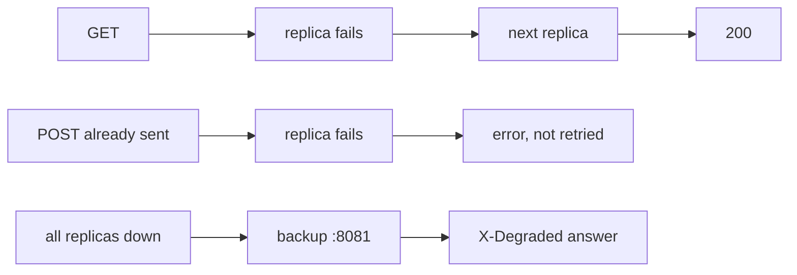

# Gatekeeper — mind map

Generated 2026-11-04 from `ebb0ac5`. Scope: the whole lab, Phases 0–11.

A map of what the project is made of and how a request moves through it. Use it as a
way in before reading the [README](../README.md); every leaf points at the file it
comes from.

## Overview

## Definition

- **What:** a hands-on lab for learning Nginx by building an API gateway → [README](../README.md)
- **Who:** someone learning Nginx, phase by phase, with real traffic
- **Job:** route, protect, cache and observe traffic to small Go services
- **Method:** every phase adds one capability, then breaks it on purpose → [Roadmap](../README.md#roadmap)
- **Proof:** a Go smoke suite checks every claim against the live stack → [services/smoke/](../services/smoke/)

## Components

- **Nginx gateway** (`nginx:1.27-alpine`, mounted read-only) → [docker-compose.yml](../docker-compose.yml)
  - **Main context:** workers, logs, maps, zones, caches → [nginx/nginx.conf](../nginx/nginx.conf)
    - `$auth_header`, `$args_without_token` maps for realtime tokens
    - `limit_req_zone` `api` 50r/s and `login` 5r/s; `limit_conn_zone` `streams`
    - `proxy_cache_path` `api_cache` and `auth_cache`
    - JSON `log_format gatekeeper`, `open_file_cache` (Phase 10 tuning)
  - **Servers** → [nginx/conf.d/](../nginx/conf.d/)
    - main HTTPS + HTTP/2 server, all routes → [default.conf](../nginx/conf.d/default.conf)
    - `admin.localhost`, basic auth, separate root → [admin.conf](../nginx/conf.d/admin.conf)
    - port 80: `/health` and redirect to HTTPS → [http-redirect.conf](../nginx/conf.d/http-redirect.conf)
    - upstream pools, keepalive, `resolve` → [upstreams.conf](../nginx/conf.d/upstreams.conf)
    - degraded orders backup on 127.0.0.1:8081 → [orders-fallback.conf](../nginx/conf.d/orders-fallback.conf)
    - `stub_status` on 127.0.0.1:8086 → [status.conf](../nginx/conf.d/status.conf)
  - **Snippets**, included, never copied → [nginx/snippets/](../nginx/snippets/)
    - proxy headers, the only `proxy_set_header` → [proxy-headers.conf](../nginx/snippets/proxy-headers.conf)
    - auth check and its error pages → [auth-check.conf](../nginx/snippets/auth-check.conf), [auth.conf](../nginx/snippets/auth.conf)
    - retry rules, idempotent only → [upstream-retry.conf](../nginx/snippets/upstream-retry.conf)
    - products cache → [cache-products.conf](../nginx/snippets/cache-products.conf)
    - TLS, CORS, gRPC errors → [tls.conf](../nginx/snippets/tls.conf), [cors-preflight.conf](../nginx/snippets/cors-preflight.conf), [grpc-errors.conf](../nginx/snippets/grpc-errors.conf)
  - **njs:** HS256 check, measured and rejected → [nginx/njs/auth.js](../nginx/njs/auth.js)
- **Go services**, one module, one Dockerfile → [services/](../services/)
  - **echo backend:** `/health`, JSON echo, chaos knobs → [internal/echo](../services/internal/echo/)
    - user, order (3 replicas), product → [cmd/](../services/cmd/)
  - **auth-service:** login, HS256 tokens, `/verify` → [internal/auth](../services/internal/auth/)
  - **realtime-service:** WebSocket, SSE, gRPC → [internal/realtime](../services/internal/realtime/)
- **Envoy twin:** same routes on 127.0.0.1:9443, for comparison → [envoy/envoy.yaml](../envoy/envoy.yaml)
- **Static content:** SPA shell and assets → [frontend/](../frontend/); admin page → [admin/](../admin/)
- **Tooling**
  - `make up`, `test`, `reload`, `bench`, `deploy` → [Makefile](../Makefile)
  - certs, secrets, readiness, bench, deploy → [scripts/](../scripts/)
  - k6 scenarios and tuning candidates → [loadtest/](../loadtest/)
  - Kubernetes examples, never applied → [k8s/](../k8s/)

## Flows

### An API request

- TLS terminates at the gateway; HTTP/2 to the client → [tls.conf](../nginx/snippets/tls.conf)
- location picked: `=`, then longest `^~` prefix, then regex → [README Routes](../README.md#routes)
- `limit_req` runs in preaccess, before `auth_request` → [nginx.conf](../nginx/nginx.conf)
- identity from the check reaches the service as `X-User-ID` → [auth-check.conf](../nginx/snippets/auth-check.conf)
- prefix replaced: `/api/orders/7` arrives as `/7` → [default.conf](../nginx/conf.d/default.conf)

### The auth check

- token from `Authorization`, or `?access_token=` on realtime routes → [nginx.conf](../nginx/nginx.conf)
- only `204` is cached; denials are re-asked → [default.conf](../nginx/conf.d/default.conf)
- DELETE needs role admin → [handler.go](../services/internal/auth/handler.go)
- Envoy checks at `/verify/<path>` and needs a 200 → [handler.go](../services/internal/auth/handler.go)

### Failover

- `max_fails`/`fail_timeout` take a replica out → [upstreams.conf](../nginx/conf.d/upstreams.conf)
- a POST is retried only if it never reached a replica → [upstream-retry.conf](../nginx/snippets/upstream-retry.conf)
- degraded reads answer, degraded writes refuse → [orders-fallback.conf](../nginx/conf.d/orders-fallback.conf)

### A cached read

- `/api/products/` cached; `X-Cache-Status` shows HIT/MISS → [cache-products.conf](../nginx/snippets/cache-products.conf)
- skipped when the request carries credentials → [nginx.conf](../nginx/nginx.conf)
- `proxy_cache_lock` sends one request per burst upstream
- `use_stale` serves old content when products is down

### Realtime and gRPC

- WebSocket: `Upgrade`/`Connection` mapped, 1h read timeout → [default.conf](../nginx/conf.d/default.conf)
- SSE: buffering off, events flush at once → [default.conf](../nginx/conf.d/default.conf)
- gRPC: `grpc_pass` over h2c; errors as `grpc-status` → [grpc-errors.conf](../nginx/snippets/grpc-errors.conf)
- `limit_conn streams` caps open streams per client → [nginx.conf](../nginx/nginx.conf)

### A rolling deploy

- one replica at a time, refuses if one is already down → [deploy.sh](../scripts/deploy.sh)
- drain = wait for the PIDs of pre-reload workers → [deploy.sh](../scripts/deploy.sh)
- 0 failed checks under k6 load → [README Zero-downtime](../README.md#zero-downtime)

## Data

- **Response cache** `api_cache` on disk, products only → [nginx.conf](../nginx/nginx.conf)
- **Auth verdict cache** `auth_cache`, key = token + method → [default.conf](../nginx/conf.d/default.conf)
- **Rate-limit zones** in shared memory, per client IP or API key → [nginx.conf](../nginx/nginx.conf)
- **Lab secrets** from `make secrets`, git-ignored → [scripts/secrets.sh](../scripts/secrets.sh)
  - `jwt.key` for auth-service only; the gateway gets it only via [docker-compose.njs.yml](../docker-compose.njs.yml)
  - `users.json` (alice, admin) and the admin htpasswd
- **Lab CA and certificate** from `make certs` → [scripts/certs.sh](../scripts/certs.sh)
- **Bench results** in `loadtest/results/`, git-ignored → [scripts/bench.sh](../scripts/bench.sh)
- No database: the services are stateless echoes

## Rules & conventions

- **One place for proxy headers:** a `proxy_set_header` in a location drops the inherited ones → [proxy-headers.conf](../nginx/snippets/proxy-headers.conf)
- **Errors nginx makes are JSON**, gRPC routes answer `grpc-status` → [default.conf](../nginx/conf.d/default.conf)
- **Client-sent identity is overwritten**, never trusted → [proxy-headers.conf](../nginx/snippets/proxy-headers.conf)
- **A POST that reached a replica is never retried:** it may have written → [upstream-retry.conf](../nginx/snippets/upstream-retry.conf)
- **Auth fails closed:** auth-service down → 503 → [auth.conf](../nginx/snippets/auth.conf)
- **Only the gateway is published;** the services stay on the compose network → [docker-compose.yml](../docker-compose.yml)
- **Tuning is measured:** kept only for a ≥10% gain, interleaved runs → [bench-compare.sh](../scripts/bench-compare.sh)
- **Config changes go out by reload**, never by recreating the gateway → [Makefile](../Makefile)
- **Every README claim has a smoke test** → [services/smoke/](../services/smoke/)

## Problems & gotchas

- **Directive inheritance:** declaring one `add_header` or `error_page` drops all inherited ones
- **`return` runs before `auth_request`:** the rewrite phase comes first
- **An unknown `auth_request` target fails open:** a 2xx from anywhere counts as allowed → [README njs](../README.md#njs)
- **`sed -i` breaks a bind mount:** it replaces the inode; edit in place → [deploy.sh](../scripts/deploy.sh)
- **`nginx -s reload` returns early:** old workers start draining later → [deploy.sh](../scripts/deploy.sh)
- **Docker DNS:** a stopped container's name vanishes; `resolve` re-resolves → [upstreams.conf](../nginx/conf.d/upstreams.conf)
- **Docker Desktop `[::1]` forwarding** can reset bursts after heavy runs → [ratelimit_helpers_test.go](../services/smoke/ratelimit_helpers_test.go)
- **njs VM per request:** only top-level code is shared → [auth.js](../nginx/njs/auth.js)
- **JS doesn't check types:** `"role":["admin"]` reads as admin → [auth.js](../nginx/njs/auth.js)
- **Envoy `ext_authz` allows only a 200**, and appends the path → [envoy.yaml](../envoy/envoy.yaml)
- **Cold benchmarks lie:** always warm up, then take medians → [bench.sh](../scripts/bench.sh)

## Glossary

- **upstream:** a named pool of backend servers nginx proxies to
- **location:** a URI match inside a server; one wins per request
- **snippet:** an `include`d config block shared by locations
- **auth_request:** nginx's subrequest-based allow/deny check
- **verdict cache:** cached `204` answers of the auth check
- **degraded:** an answer from the orders backup, marked `X-Degraded`
- **drain:** wait until in-flight requests on a replica finish
- **chaos knobs:** `DELAY_MS` / `FAIL_RATE` env on the echo services
- **candidate:** a tuning change in `loadtest/candidates/`, measured by `bench-compare`
- **twin:** the Envoy gateway mirroring nginx's core routes
- **lifecycle tests:** smoke tests that stop or recreate containers

## Where to start reading

1. [README.md](../README.md): Architecture, Getting started, Routes
2. [nginx/nginx.conf](../nginx/nginx.conf): the main context, maps and zones
3. [nginx/conf.d/default.conf](../nginx/conf.d/default.conf): every route, top to bottom
4. [nginx/snippets/proxy-headers.conf](../nginx/snippets/proxy-headers.conf) and [auth-check.conf](../nginx/snippets/auth-check.conf): what every proxied request gets
5. [services/smoke/](../services/smoke/): pick a test for any README claim and run it
